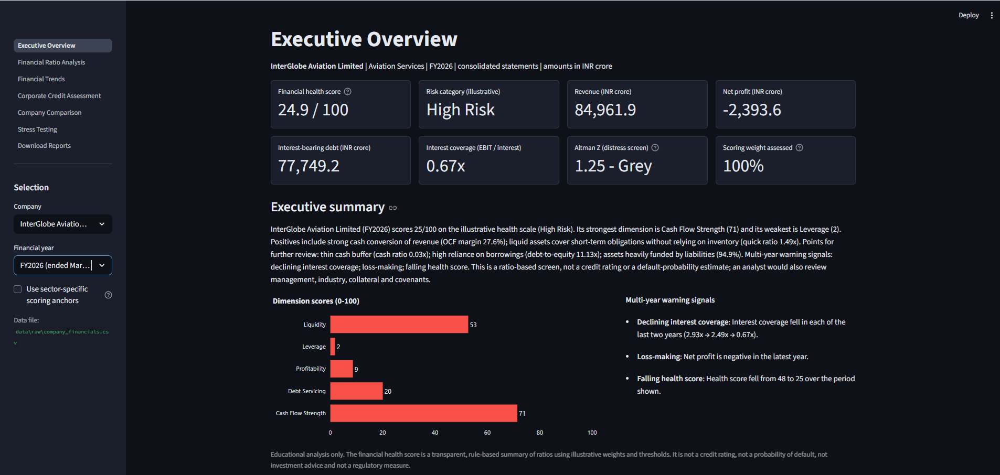
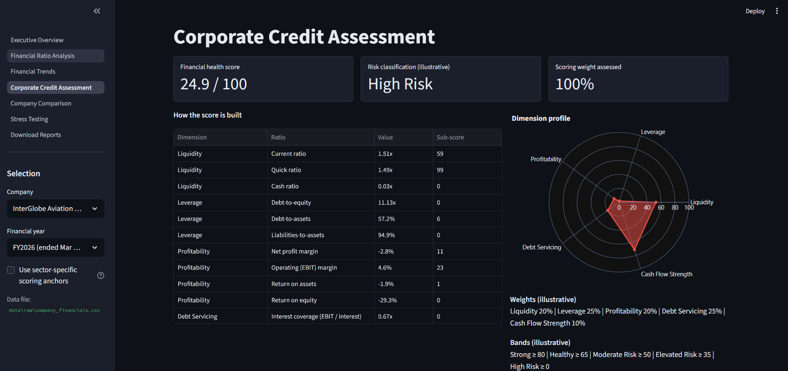
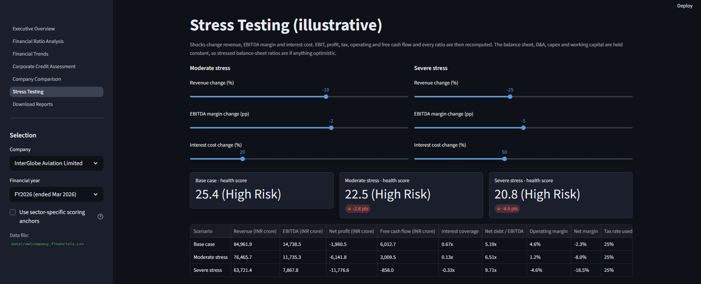

# CorporateRisk — Company Credit Health Check

An educational corporate credit-analysis toolkit. It reads a company's balance sheet, income statement and
cash-flow statement and then:
- calculates 15 financial ratios with explicit handling of undefined cases;
- builds a transparent 0–100 financial health score;
- screens for financial distress with the Altman Z-score family;
- tracks multi-year deterioration signals;
- compares companies;
- runs statement-level stress tests.

Results are presented in a 7-page Streamlit dashboard, a PDF credit assessment and a formatted Excel workbook.

> **Important.** The real dataset covers **Asian Paints, UltraTech Cement and InterGlobe Aviation,
> FY2024-FY2026**, using consolidated annual reports in **INR crore**. Every financial figure is cited to
> a PDF page in [`data/raw/extraction_review.csv`](data/raw/extraction_review.csv).
> The financial health score uses illustrative weights and is **not a credit rating or a probability of default**
> and is not a regulatory measure.



*InterGlobe Aviation, FY2026 - executive overview in dark mode.*

## 1. Business objective
A credit analyst reviewing a corporate borrower needs to answer four questions quickly and transparently:
- Can the company meet its short-term obligations (liquidity)?
- How much does it rely on borrowed money (leverage)?
- Does the business earn enough (profitability)?
- Can its earnings and cash flows service its debt?

CorporateRisk structures that review, shows every number behind the conclusion, flags data gaps instead
of hiding them, and tests how the picture changes under stress.

## 2. Financial Risk Management
* **Corporate credit risk:** the ratio-based financial-risk assessment that underlies bank credit appraisal
  and internal rating models.
* **Financial modelling:** statement-level stress testing that recomputes EBIT, profit, tax and cash flows
  instead of applying a flat haircut.
* **Model governance habits:** documented assumptions in one config file, validation checks, explicit handling
  of edge cases (negative equity, negative EBITDA, zero debt), coverage disclosure and stated limitations.
* **Communication:** plain-language analyst commentary and a client-style PDF report.

## 3. Technology
Python 3.11 · pandas · NumPy · Matplotlib · Plotly · Streamlit · ReportLab · OpenPyXL · pytest.
No databases, cloud services or deep learning.

## 4. Architecture
```
data/raw/company_financials.csv  (your real data)   ─┐
data/sample/synthetic_financials.csv (demo)          ─┴─► data_loader ─► data_validation
   ─► financial_ratios (value + status) ─► financial_scoring ─► altman_zscore ─► trend_analysis
   ─► company_comparison ─► stress_testing ─► report_generator (PDF) / excel_export / dashboard
```
`src/corporaterisk/pipeline.py` runs these steps once, so every output shows identical numbers.

| Folder | Contents |
|---|---|
| `src/corporaterisk/` | the analysis library (config, loading, validation, ratios, scoring, Z-score, trends, comparison, stress, PDF, Excel) |
| `dashboard/` | Streamlit app, 7 pages |
| `scripts/` | `prepare_data.py`, `generate_reports.py`, `generate_synthetic_data.py` |
| `notebooks/` | `financial_analysis.ipynb`, an executed walkthrough |
| `tests/` | 54 pytest tests on small synthetic fixtures |
| `docs/` | methodology, ratios explained, data sources, limitations, interview notes |
| `reports/sample_reports/` | real-company sample PDF and Excel outputs |

## 5. Data sources
| Dataset | File | Coverage |
|---|---|---|
| Real company data (used by the application) | `data/raw/company_financials.csv` | Asian Paints, UltraTech Cement and InterGlobe Aviation; FY2024-FY2026; consolidated; INR crore |
| Source register | `data/sources.csv` | Annual-report names, basis, units and extraction conventions for every company |
| Figure-level citations | `data/raw/extraction_review.csv` | PDF file/page, original line, unit conversion, derived inputs and separately cited debt components |
| Synthetic test dataset | `data/sample/synthetic_financials.csv` | Four fictional companies used for testing, including unit-test edge cases |

The real-data conventions are:
- A printed dash means **nil (0)**; an absent line remains blank.
- Debt includes current and non-current **borrowings plus lease liabilities (Ind AS 116)**.
- **FCF = OCF - capex - lease principal repaid** when provided. Missing lease principal retains
  before-lease FCF with an explicit basis note; OCF/debt is unchanged.
- Capex uses **printed PPE/intangible purchase lines only**, entered as positive outflows; asset-sale
  proceeds are not netted. UltraTech's printed PPE line includes CWIP and capital advances;
  intangible purchases are not separately reported in its consolidated cash flow.
- Market capitalisation uses only printed **31 March** values; **NSE** is selected where exchange-specific
  values are printed (UltraTech). Asian Paints uses printed issuer market values; InterGlobe is blank.
  No market value is calculated from share prices.
- FY2026 and FY2025 come from the FY2026 reports' current/comparative columns; FY2024 comes from
  the FY2025 reports' comparative column. Restated comparatives and presentation changes are noted
  in the extraction review. EBIT uses PBT after exceptional items plus finance costs; EBITDA adds D&A.

Annual-report PDFs are local source documents and are excluded from this repository. The application uses
`data/raw/company_financials.csv` when present; the synthetic set is retained for testing. See
[`docs/data_sources.md`](docs/data_sources.md) for extraction guidance.

## 6. Financial ratios
| Dimension | Ratios |
|---|---|
| Liquidity | current, quick, cash |
| Leverage | debt/equity, debt/assets, liabilities/assets |
| Profitability | net margin, EBIT margin, ROA, ROE (average balances) |
| Debt servicing | EBIT/interest, net debt/EBITDA, operating cash flow/debt |
| Cash flow | OCF margin, free cash flow, FCF/debt |

Debt includes interest-bearing borrowings and lease liabilities, never total liabilities. Each ratio carries a status:
- **`ok`**
- **`missing_input`**
- **`zero_denominator`**
- **`not_applicable`**, e.g. interest cover for a debt-free company
- **`adverse_undefined`**, e.g. negative equity or EBITDA ≤ 0

An undefined ratio is never shown or scored as zero. Plain-language explanations with worked examples are in
`docs/financial_ratios_explained.md`.

## 7. Scoring methodology (illustrative)
1. **Ratio sub-scores:** each ratio is mapped linearly to 0–100 between a weak and a strong anchor.
2. **Dimension scores:** the sub-scores are averaged within each dimension.
3. **Overall score:** the dimensions are weighted **Liquidity 20% · Leverage 25% · Profitability 20% · Debt
   servicing 25% · Cash flow 10%**.
4. **Bands:** Strong ≥ 80 · Healthy ≥ 65 · Moderate Risk ≥ 50 · Elevated Risk ≥ 35 · High Risk < 35.

How undefined ratios are scored:
- **Adverse** ratios score 0.
- **Missing or not-applicable** ratios are excluded, and the remaining weights are rescaled.
- **Coverage** (the share of applicable scoring weight that was actually assessed) is shown with every
  score. Below 70% the score is flagged provisional.

All weights, anchors and bands are in `src/corporaterisk/config.py`. Optional sector-specific anchors are
available but off by default. The full method is in `docs/methodology.md`.

**Altman Z-score:** three variants are kept separate:
- **original Z (1968):** listed manufacturers;
- **Z′ (1983):** private manufacturers;
- **Z″ (1995):** non-manufacturers and emerging markets.

Each variant has its own coefficients and zones. It is chosen once per company and is "not computable" if an
input is missing.

**Stress testing:** shocks to revenue, EBITDA margin and interest cost are pushed through the statements:
EBIT → PBT → tax → net profit → operating and free cash flow. All ratios and the score are then recomputed.
The balance sheet is held constant, and this is stated.

### Results (illustrative)

Computed from `data/processed/health_scores.csv` and `altman_zscores.csv` using the documented conventions.
All nine company-years have 100% weighted ratio coverage.

| Company | Financial year | Health score / 100 | Category | Altman variant | Zone |
|---|---|---:|---|---|---|
| Asian Paints Limited | FY2024 | 92.1 | Strong | Z'' | Safe |
| Asian Paints Limited | FY2025 | 87.2 | Strong | Z'' | Safe |
| Asian Paints Limited | FY2026 | 91.4 | Strong | Z'' | Safe |
| InterGlobe Aviation Limited | FY2024 | 47.6 | Elevated Risk | Z'' | Grey |
| InterGlobe Aviation Limited | FY2025 | 47.0 | Elevated Risk | Z'' | Grey |
| InterGlobe Aviation Limited | FY2026 | 24.9 | High Risk | Z'' | Grey |
| UltraTech Cement Limited | FY2024 | 70.1 | Healthy | Original Z | Safe |
| UltraTech Cement Limited | FY2025 | 57.9 | Moderate Risk | Original Z | Safe |
| UltraTech Cement Limited | FY2026 | 66.3 | Healthy | Original Z | Safe |

## 8. Dashboard
| Page | What it shows |
|---|---|
| Executive Overview | score, category, revenue, profit, debt, interest cover, Z-score, coverage, executive summary, dimension chart, warning signals |
| Financial Ratio Analysis | all 15 ratios by dimension for 3 years, status, formulas and interpretation |
| Financial Trends | revenue/profit, cash flows, margins, coverage, leverage/liquidity, score trend; growth table; deterioration signals |
| Corporate Credit Assessment | how the score is built (every sub-score), dimension radar, strengths, weaknesses, warnings, Z-score components, analyst commentary, data checks |
| Company Comparison | side-by-side ratios and scores, with a sector caveat |
| Stress Testing | adjustable scenarios, recomputed metrics and scores |
| Download Reports | PDF credit assessment, Excel ratio workbook, CSV ratio data |

## 9. Installation (Windows 10/11, Python 3.11, VS Code)
1. Install **Python 3.11** from python.org, ticking **"Add python.exe to PATH"** and **"py launcher"**.
2. In VS Code: **File → Open Folder** → select `CorporateRisk-Company-Credit-Health-Check`.
3. Double-click **`setup_project.bat`**, or run it in the VS Code terminal (**Terminal → New Terminal**):
   ```bat
   setup_project.bat
   ```
   It creates `.venv`, installs the dependencies, checks the imports and validates the data. It calls
   `.venv\Scripts\python.exe` directly, so PowerShell activation and execution-policy changes are not
   needed. If VS Code asks which interpreter to use, choose `.venv` (**Ctrl+Shift+P → Python: Select
   Interpreter**).

## 10. Running
```bat
run_project.bat      :: dashboard at http://localhost:8501
run_tests.bat        :: pytest; non-zero exit code if any test fails
.venv\Scripts\python.exe scripts\generate_reports.py     :: PDFs + Excel into outputs\
```
VS Code **Run and Debug** also has configurations for the dashboard, data preparation, report generation
and tests.

## 11. Screenshots
Real consolidated company data displayed in the dark-mode Streamlit dashboard.


*InterGlobe Aviation, FY2026 - executive overview and financial health indicators.*



*InterGlobe Aviation, FY2026 - ratio sub-scores and credit assessment.*



*InterGlobe Aviation, FY2026 - illustrative moderate and severe stress scenarios.*

## 12. Limitations
Full list: `docs/limitations.md`. In short:
- **Not a rating or a PD.** The score is not a credit rating or a probability of default, and its weights
  are not calibrated to observed defaults.
- **Synthetic test data.** The separate synthetic dataset is fictional; the screenshots and sample reports use real companies.
- **IndiGo leases.** Lease repayments are net of incentives as printed. Lease-funded fleet additions appear in debt, not capex.
- **FY2024 tax credit.** InterGlobe's printed tax credit makes net profit exceed PBT; the validation warning is retained.
- **Annual figures only.** There is no view of off-balance-sheet exposures, covenants, collateral, debt
  maturities or management quality.
- **Altman zones** come from historical, mostly US samples.
- **Stress tests** are sensitivities with the balance sheet held constant.

## 13. Future improvements
* More real companies per sector, with sector-specific benchmarks.
* A DSCR and debt-maturity view, which needs the repayment schedule.
* With a labelled dataset of corporate defaults: a logistic PD model to test whether the score ranks risk.
* Macro-linked stress scenarios, with the balance sheet rolled forward over several years.

## License
MIT. See `LICENSE`.
